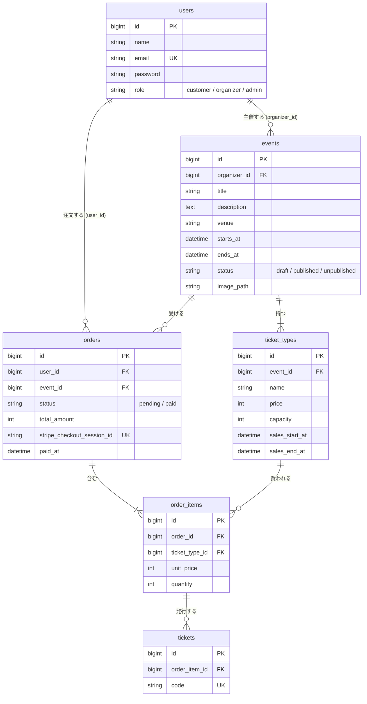

# データベース設計

## ER 図



<br>

## テーブル定義

全テーブルに `id`（bigint、PK）と `created_at` / `updated_at` を持つ。以下の表では省略する。

### users（既存テーブルに追加）

| カラム | 型 | 制約 | 説明 |
|-|-|-|-|
| role | string(20) | NOT NULL、default `customer`、index | ロール。PHP の Enum `UserRole`（`Customer` / `Organizer` / `Admin`）でキャストする |

- 既存のカラム（`name`、`email`、`password`、`email_verified_at`、2段階認証のカラムなど）はそのまま使う

### events

| カラム | 型 | 制約 | 説明 |
|-|-|-|-|
| organizer_id | foreignId → users.id | NOT NULL、restrict | 主催者 |
| title | string(100) | NOT NULL | イベント名 |
| description | text | NOT NULL | 説明 |
| venue | string(100) | NOT NULL | 会場 |
| starts_at | datetime | NOT NULL | 開始日時 |
| ends_at | datetime | NOT NULL | 終了日時（starts_at より後） |
| status | string(20) | NOT NULL、default `draft` | `draft`（下書き）/ `published`（公開）/ `unpublished`（管理者による非公開）。Enum `EventStatus` |
| image_path | string | NULL 可 | 画像のパス（拡張 E14） |

- index: `(status, starts_at)`（公開一覧を開催日順に出すため）

### ticket_types

| カラム | 型 | 制約 | 説明 |
|-|-|-|-|
| event_id | foreignId → events.id | NOT NULL、cascade | イベント |
| name | string(50) | NOT NULL | 券種名（一般、学生など） |
| price | unsignedInteger | NOT NULL | 価格（円）。0 は無料券 |
| capacity | unsignedInteger | NOT NULL | 定員 |
| sales_start_at | datetime | NOT NULL | 販売開始 |
| sales_end_at | datetime | NOT NULL | 販売終了 |

### orders

| カラム | 型 | 制約 | 説明 |
|-|-|-|-|
| user_id | foreignId → users.id | NOT NULL、restrict | 注文者 |
| event_id | foreignId → events.id | NOT NULL、restrict | 対象イベント（1注文 = 1イベント） |
| status | string(20) | NOT NULL、default `pending` | `pending`（支払い待ち）/ `paid`（支払い済み）。Enum `OrderStatus` |
| total_amount | unsignedInteger | NOT NULL | 合計金額（円） |
| stripe_checkout_session_id | string | NULL 可、unique | Checkout Session の ID。作成前と 0 円の注文は NULL |
| paid_at | datetime | NULL 可 | 支払い確定日時 |

- index: `(event_id, status)`（主催者の売上集計のため）

### order_items

| カラム | 型 | 制約 | 説明 |
|-|-|-|-|
| order_id | foreignId → orders.id | NOT NULL、cascade | 注文 |
| ticket_type_id | foreignId → ticket_types.id | NOT NULL、restrict | 券種 |
| unit_price | unsignedInteger | NOT NULL | 注文時点の単価（円） |
| quantity | unsignedSmallInteger | NOT NULL | 枚数（1 以上はバリデーションで保証） |

- unique: `(order_id, ticket_type_id)`

### tickets

| カラム | 型 | 制約 | 説明 |
|-|-|-|-|
| order_item_id | foreignId → order_items.id | NOT NULL、cascade | 明細 |
| code | string(26) | NOT NULL、unique | チケット固有のコード（ULID など推測しにくい値） |

<br>

## 外部キーの削除時の動き

| 外部キー | 動き | 理由 |
|-|-|-|
| events.organizer_id | restrict | イベントと売上の記録を消さない |
| ticket_types.event_id | cascade | 券種はイベントの一部 |
| orders.user_id | restrict | 注文の記録は残す |
| orders.event_id | restrict | 注文があるイベントは消せない |
| order_items.order_id | cascade | 明細は注文の一部 |
| order_items.ticket_type_id | restrict | 売れた券種は消せない（T5 の担保） |
| tickets.order_item_id | cascade | チケットは明細の一部 |

- restrict のため、注文がある参加者やイベントがある主催者は、既存の「アカウント削除」で削除するとエラーになる。削除前に確認してメッセージを出す
- イベント削除は `pending` の注文でも restrict で止まる。削除前に `pending` の注文をアプリ側で消してから削除する（支払い済みがあれば削除させない）

<br>

## 残り枚数の計算

残り枚数はカラムに持たず、表示や購入チェックのたびに計算する。

```
残り枚数 = ticket_types.capacity − 確保済みの枚数

確保済みの枚数 = 次の注文に含まれる order_items.quantity の合計
  - status が paid の注文
  - status が pending で、created_at が 15 分以内の注文
```

- 15 分を過ぎた `pending` の注文は、支払いを中断したものとみなし、枠を自動で空ける（定期処理は不要）
- 15 分は Stripe Checkout Session の有効期限を考慮して決める値。定数か config に置く
- 一覧や詳細では `withSum()` などで券種ごとに集計し、N+1 にしない

### カラムで持たない理由

- 時間の経過（pending の期限切れ）だけで値が変わるため、カラムだと定期的に戻す処理が必要になる
- 注文作成、支払い確定、期限切れ、返金、定員の変更など、更新すべき場所が多く、1か所でも漏れるとずれる
- 同時購入や途中の例外で、注文と残り枚数が食い違う

### 既知の制約

- 「残りを確認してから注文を作る」間に他の人が割り込めるため、同時購入で定員を超える可能性がある。コアでは許容し、拡張 E2 でトランザクションと行ロックで対策する
